# Space Nova: a beginner's guide

Welcome, Commander. You start with one planet and an unexplored galaxy. This
guide covers your first hour: growing your home world, building your first
ships, and finding out what's out there.

## 1. Create your commander

Open the game and pick **New commander**. Choose a name and a password, and
you're in. The line under the logo shows which universe you're joining and how
fast it runs.

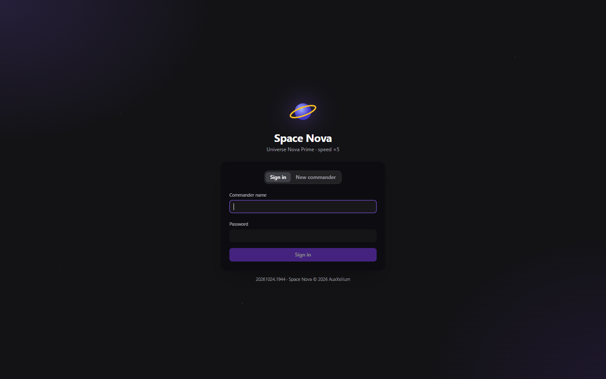

## 2. Collect your welcome rewards

For your first two weeks, a welcome reward is waiting each day you play:
resources, ships, xenite and more, seven in all. They open by themselves while
today's is waiting; after that, the **gift button** in the top bar opens them.
Day 3 brings 10 Spy Probes and 5 Small Cargo ships, just right for exploring.

Every fifth player level also earns a reward in the same window, so check back
as you grow.

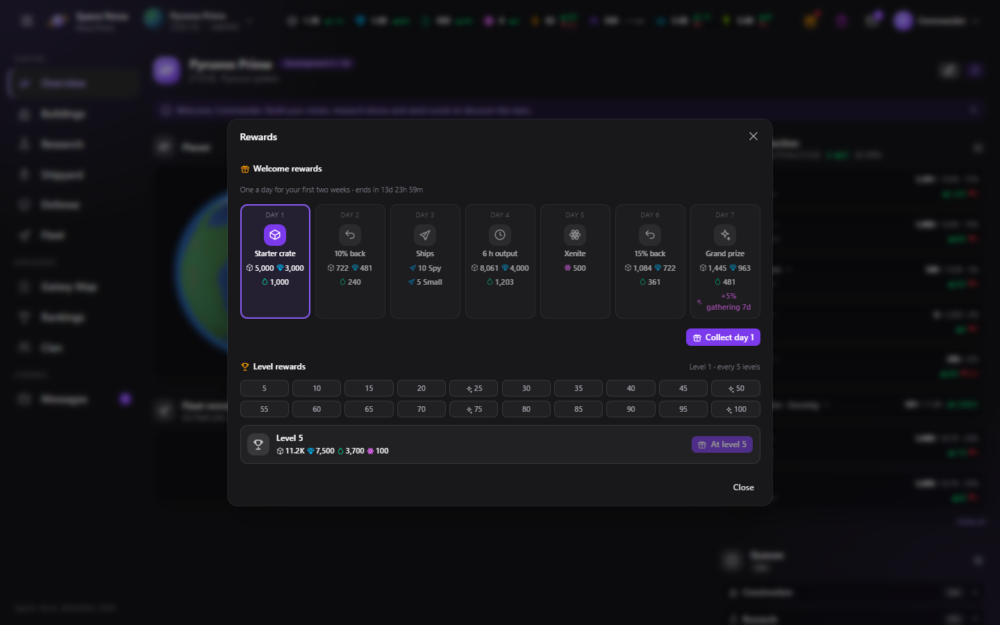

## 3. Your home planet

The **Overview** shows your planet at a glance:

- **The top bar** lists your resources: metal, crystal, deuterium, xenite,
  energy, people, water and food. The small green and red numbers show how
  much you gain and use each hour.
- **Production** shows how full each store is and how long until it fills.
  Click a resource to see where it comes from and where it goes.
- **Queues** show what is being built or researched and when it finishes.

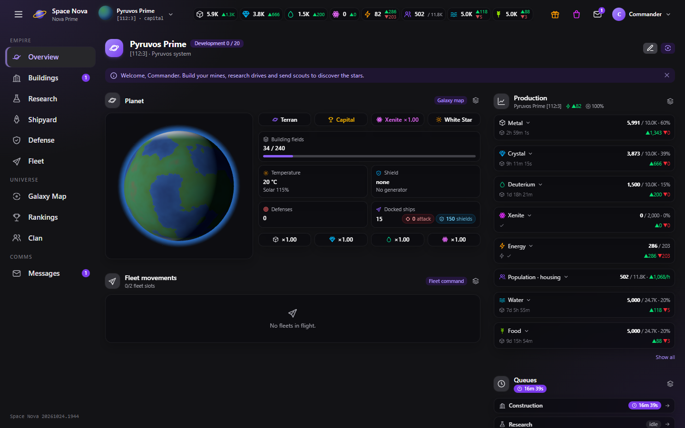

## 4. Build up your economy

On the **Buildings** page, start with the basics:

- **Metal Extractor**, **Crystal Refinery** and **Deuterium Synthesizer**
  produce your three main resources.
- **Solar Array** makes the energy they run on. If energy turns red in the top
  bar, build more before anything else, because mines produce less without it.
- **Habitat**, **Water Extractor** and **Hydroponic Farm** grow your
  population. People are the crews your buildings and ships need.
- **Research Lab** and **Shipyard** unlock research and ships.

You can line up to five orders; they're built one after another. Each building
takes up space on your planet (the **Fields** bar at the top right).

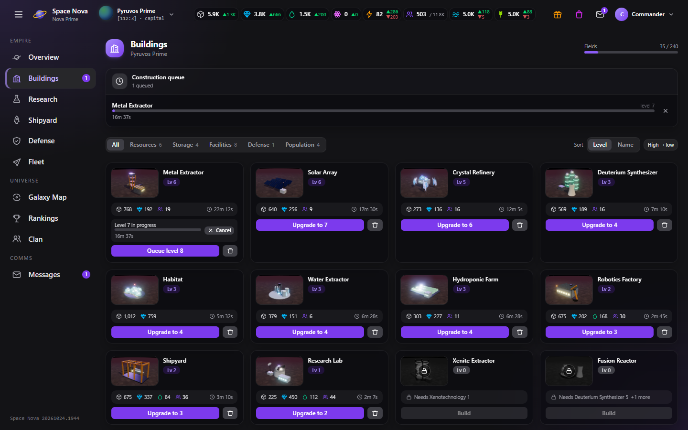

> **Tip:** A locked card tells you what it still needs, for example
> "Needs Xenotechnology 1". Click a card's picture to see what the building does.

## 5. Research

Research makes everything better, and it counts on every planet you'll ever
own. Begin with **Energy Technology**, then **Combustion Drive**: you need it
to build Spy Probes, your first explorers.

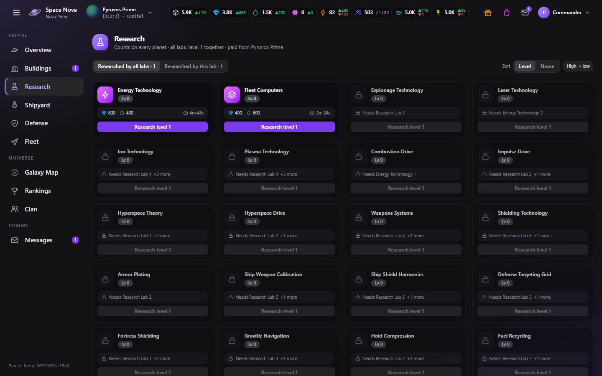

## 6. Build your first ships

The **Shipyard** builds ships; the tabs sort them into warships, civil ships
and exploration ships. To start out, you need:

- **Spy Probes**: tiny and very fast, perfect for scouting.
- **Small Cargo**: for moving resources between your planets.

The number under each ship is how many you have docked.

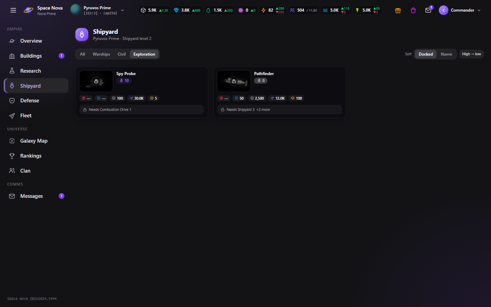

## 7. The Galaxy Map

The galaxy is made of star systems, and **every planet starts undiscovered**.
Nobody knows what a world holds until a fleet reaches it.

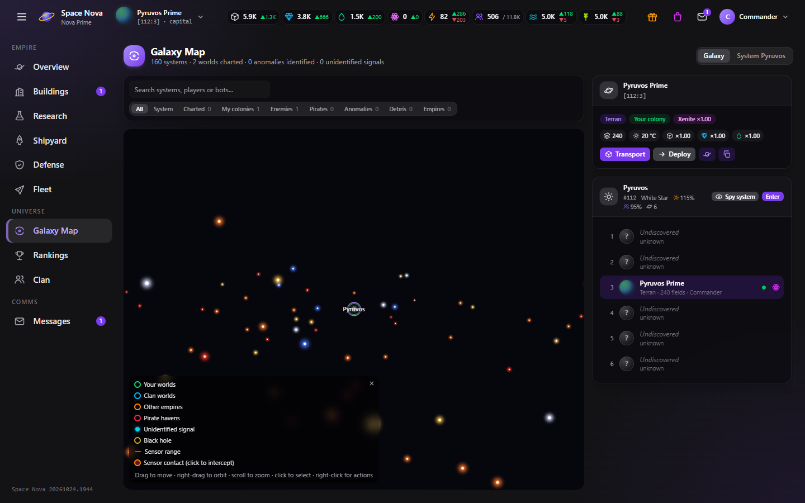

**Moving around the map:**

| Mouse | What it does |
|-------|--------------|
| Left drag | Move across the galaxy |
| Right drag | Rotate the view |
| Scroll | Zoom in and out |
| Click | Select a star, planet or anomaly |
| Right-click | Open its actions |

On a phone or tablet, drag with one finger to rotate and pinch to zoom.

Use the **search box** above the map to find systems, players or bots, and the
**filters** to show only the stars you've charted, your colonies, enemies,
pirates or anomalies.

Click a star and press **Enter** to look inside the system. Select a planet
to see its details and actions at the top of the side panel.

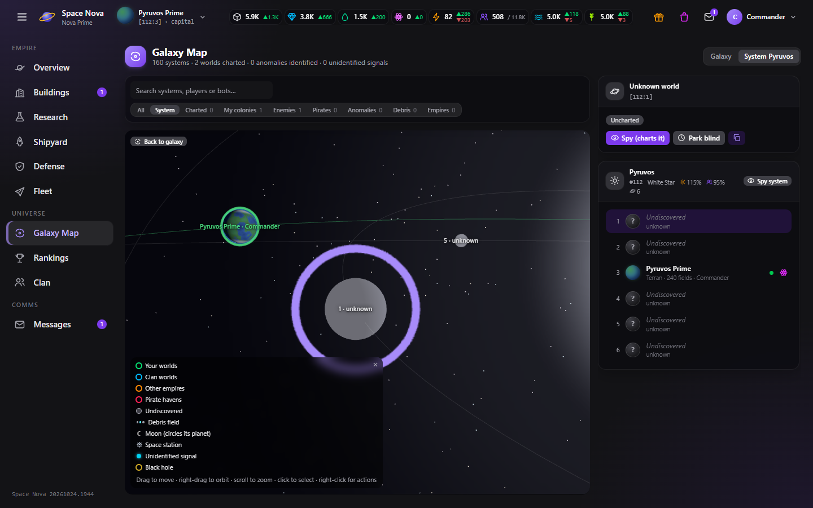

## 8. Explore: send your first spy mission

Select an undiscovered planet and press **Spy (charts it)**. The fleet
dispatcher opens in three steps:

1. **Target & mission**: already filled in when you start from the map.
2. **Ships**: choose how many Spy Probes to send. Two are plenty for an
   uncharted world.
3. **Cargo & options**: not needed for spying.

The dispatcher shows the flight time and the fuel before you launch. Use
**Launch at** or **Arrive at** to time a flight for later.

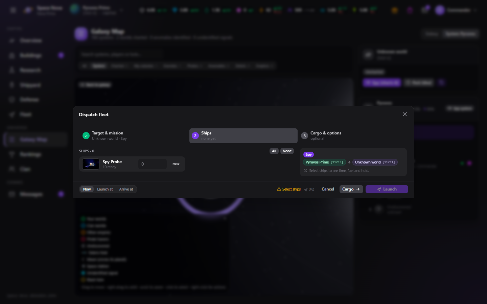

**Want to chart a whole system at once?** Press **Spy system** on the system
card. It sends a probe to every planet worth a look in one go.

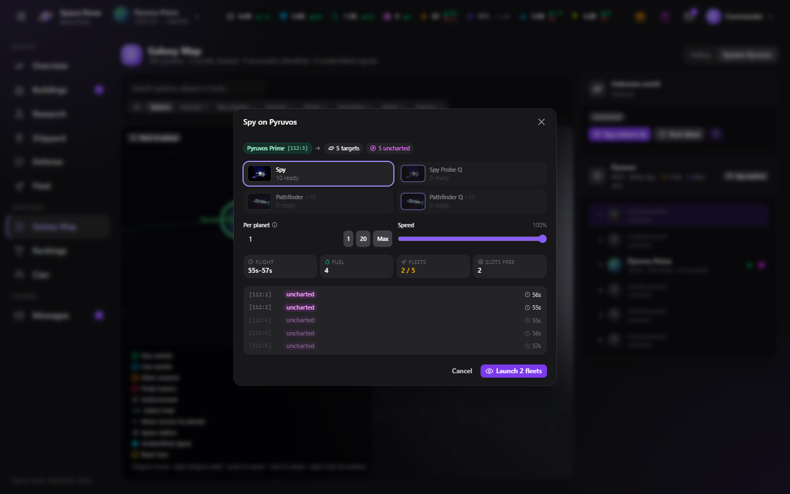

## 9. Follow your fleets

**Fleet Command** (the **Fleet** page) tracks everything you've sent out:

- **Active**: fleets on their way, with a countdown. Click the arrow to recall
  one.
- **History**: missions that are over, each with a summary on the right of how
  it went ("Charted", "Player world", "Pirate haven found", ...).
  Click a mission to read its reports.
- **Radar**: foreign fleets your scanners can see.

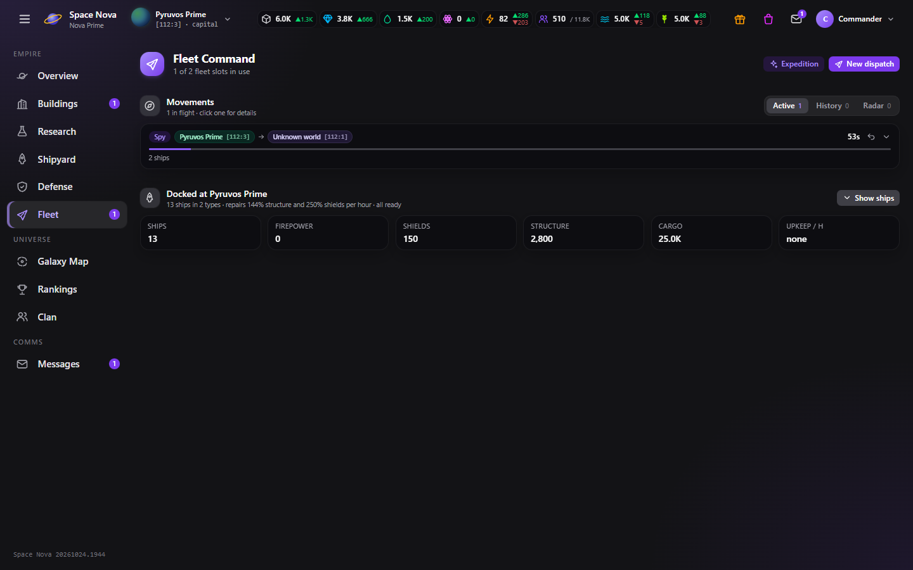

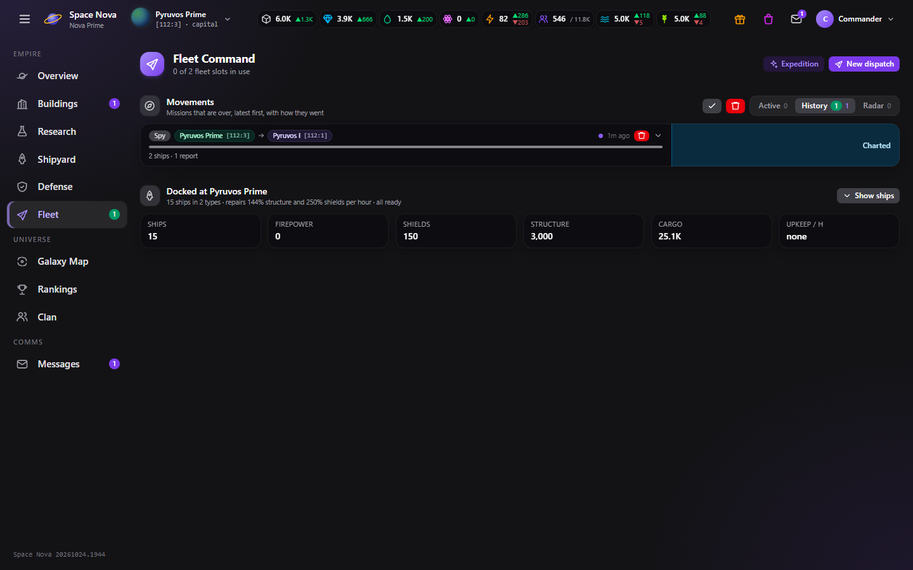

## 10. What you might find

When your probes reach a new world, it is revealed for the first time. It can
be a terran, desert, ocean, ice, volcanic, toxic, crystalline, barren or gas
giant world, each with its own size and riches. You might also find:

- **Nothing but the planet**: a free world you can settle later.
- **Another empire's home**: your probes send back what they saw. Spy reports
  appear in **Messages** under **Spy**.
- **A pirate haven**: pirates hold the world and must be defeated before
  anyone can settle there.
- **Derelict ships, supply caches or ancient archives**: free ships,
  resources or research.
- **An unidentified signal**: a mysterious anomaly at the edge of the system.
  Send a fleet to find out what it is. It could be treasure, drifting ships,
  or a trap.

## 11. Where to go next

- **Colonize.** Build a Colony Ship and send it to a free world you've
  charted. You can hold four planets at first; the Command Nexus on your
  capital raises the limit.
- **Defend.** Pirates and other players may come for your resources. Build
  defenses and a Planetary Shield, and keep an eye on the Radar.
- **Expeditions.** The **Expedition** button on the Fleet page sends ships into
  deep space to search for resources and lost ships. It's a gamble, but often
  pays off.
- **Join a clan.** On the **Clan** page you can found or join a clan: share
  your star charts, guard each other's planets and attack together.
- **Talk.** Write to other commanders from **Messages**, the Rankings or their
  planets on the map.

> **Tip:** Almost everything has a right-click menu: planets, stars, fleets,
> ships, queue entries and messages. It's the quickest way to get things done.

Good luck out there, Commander.
