# Buildings

[← Back to the beginner's guide](../README.md)

Buildings are the heart of every planet. Each kind takes one building field,
however far you upgrade it (see [Your planets](planets.md)). Click a building's
picture in the game to see what its next level brings, and **All levels** to
compare every level.

> **Tip:** A building you can't build yet shows what it still needs, such as a
> research or another building. Higher levels of some buildings need research
> too.

## Resources

| | |
|---|---|
| 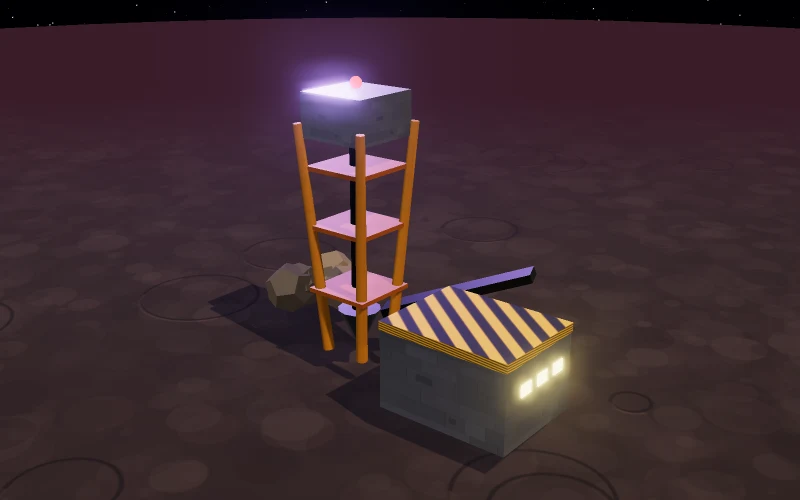 | **Metal Extractor** Mines metal, the resource you need most. Start here and keep upgrading it. |
| 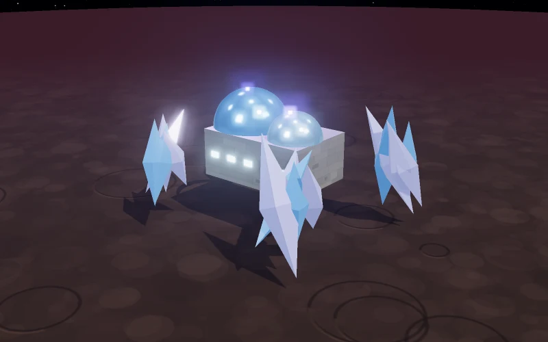 | **Crystal Refinery** Produces crystal for electronics, research and better ships. |
| 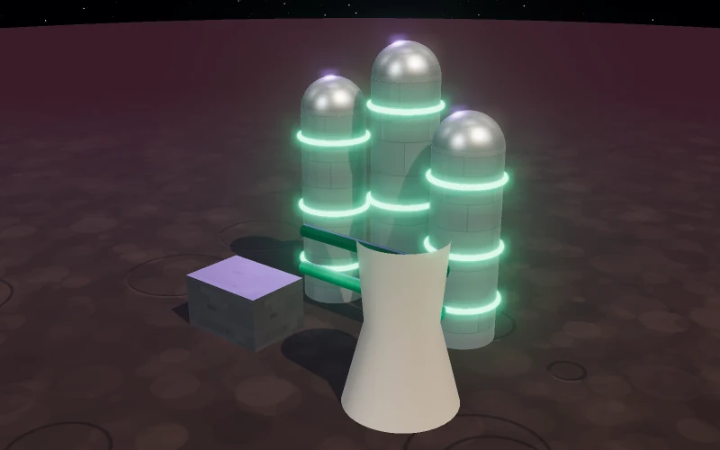 | **Deuterium Synthesizer** Extracts deuterium, the fuel of your fleets. Cold worlds produce more. |
| 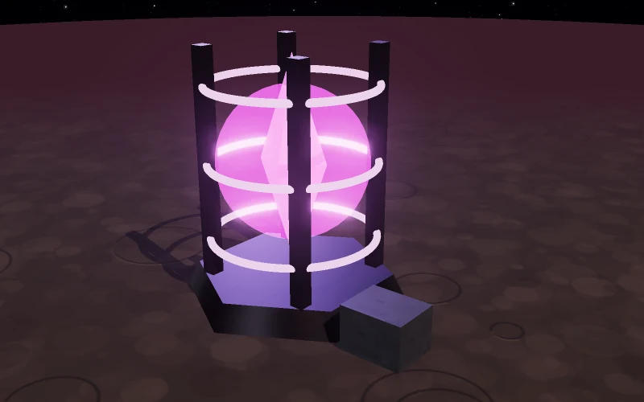 | **Xenite Extractor** Mines xenite, a rare mineral found only on some worlds. Needed for the heaviest ships and the top levels of many buildings. Needs Xenotechnology. |
| 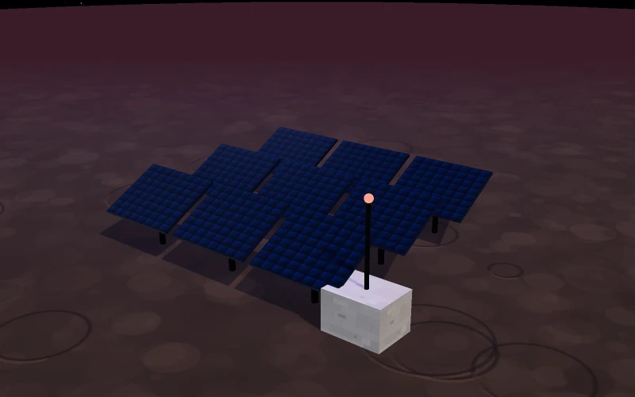 | **Solar Array** Clean energy from starlight, no fuel needed. Brighter stars give more power. |
| 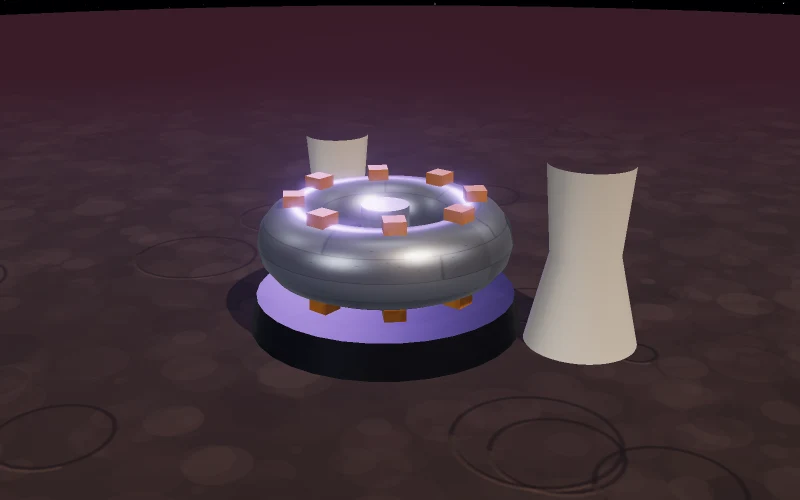 | **Fusion Reactor** Burns deuterium for a lot of energy, whatever the star. Great when solar power isn't enough. |

## Storage

| | |
|---|---|
| 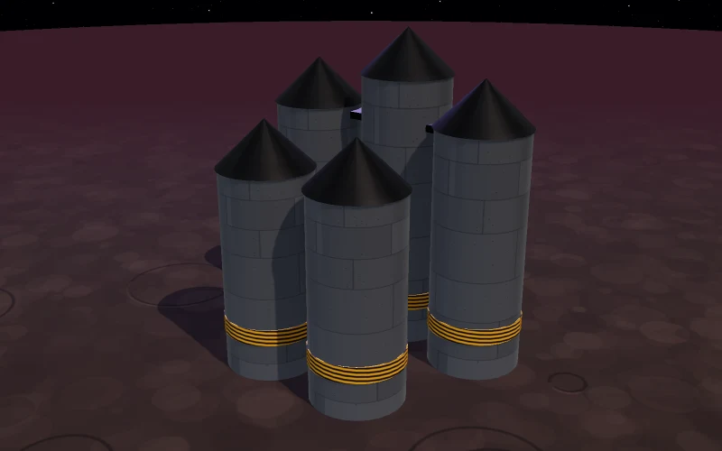 | **Metal Vault** Raises how much metal the planet can hold. Its top level holds any amount. |
| 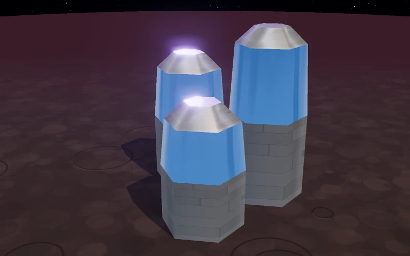 | **Crystal Vault** The same for crystal. |
| 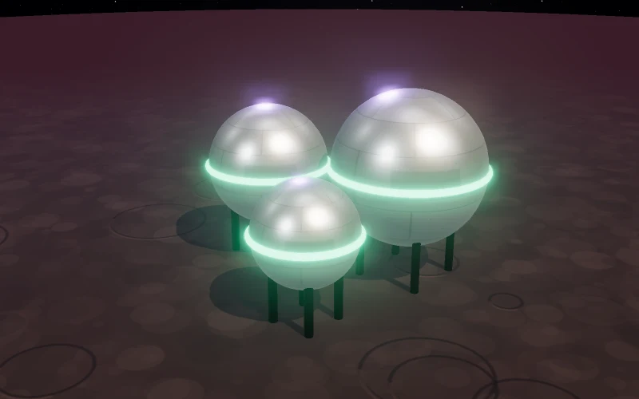 | **Deuterium Tank** The same for deuterium. |
| 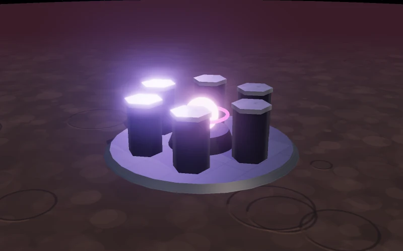 | **Xenite Vault** Keeps much more xenite than an extractor can hold. Works on any planet, so you can store xenite you shipped in. |

## Population

| | |
|---|---|
| 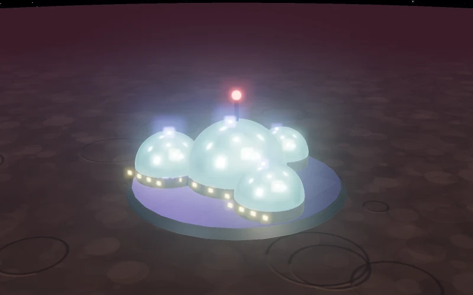 | **Habitat** Living space. Every level lets more people live on the planet, and bigger planets hold more people per level. |
| 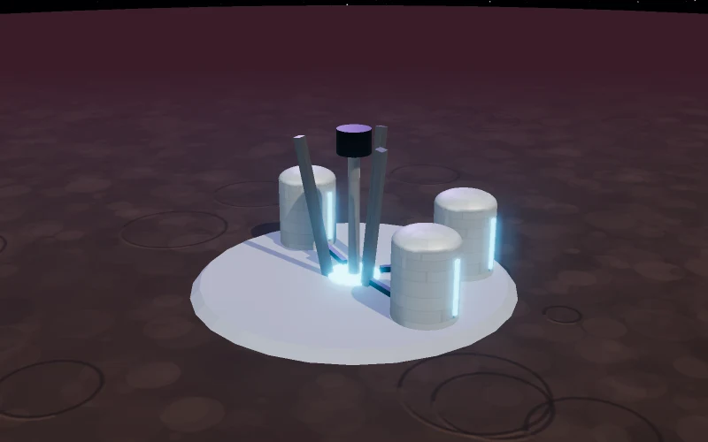 | **Water Extractor** Supplies water for your people. Best on cold, icy and ocean worlds. Needs no energy. |
| 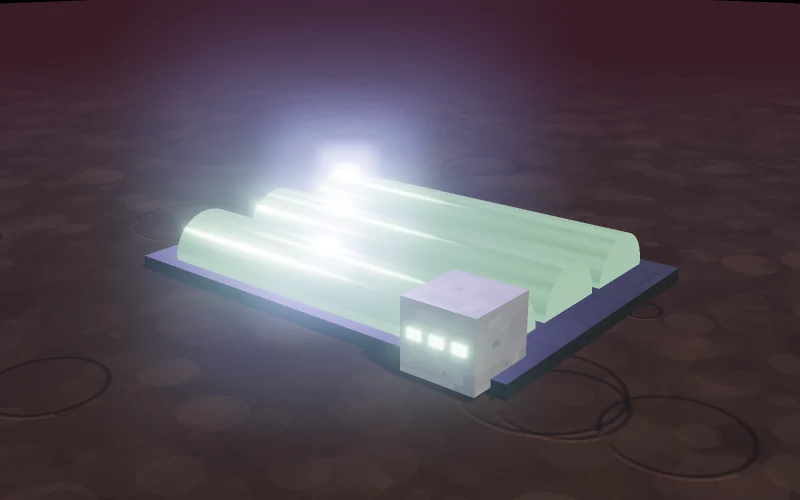 | **Hydroponic Farm** Grows food for your people. Best on terran and ocean worlds. Needs no energy. |
| 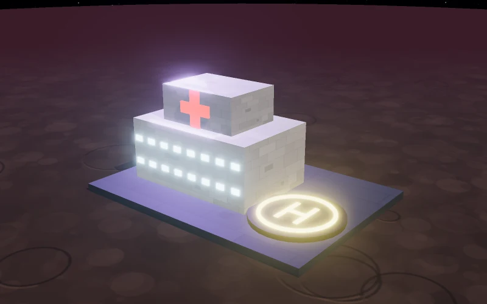 | **Hospital** Heals the sick when an illness breaks out, and makes outbreaks rarer. Each level heals faster and cheaper. See [Dangers](dangers.md#illness). |

## Facilities

| | |
|---|---|
| 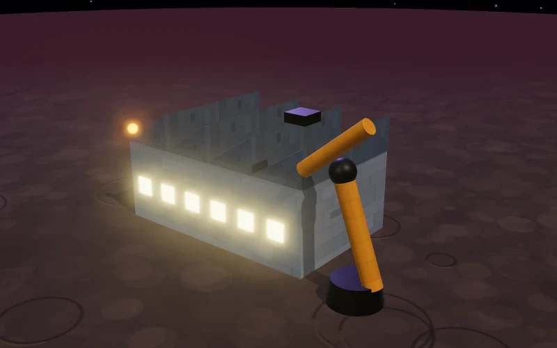 | **Robotics Factory** Construction drones: every level builds faster, and it speeds up the Shipyard too. It also repairs damaged ships and defenses faster. |
| 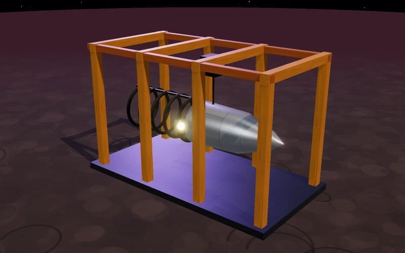 | **Shipyard** Builds ships and defenses. Higher levels unlock bigger ships and build faster. Damaged ships docked here are repaired faster. |
| 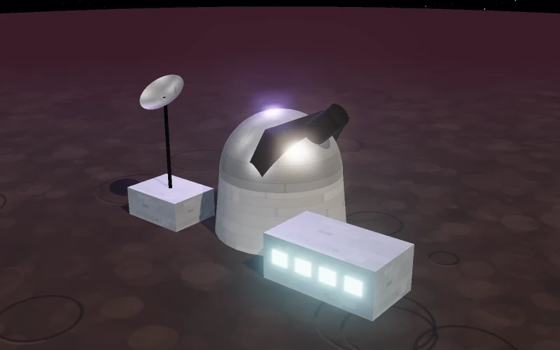 | **Research Lab** Needed for research. Higher levels research faster and unlock more. The labs of all your planets can work together. |
| 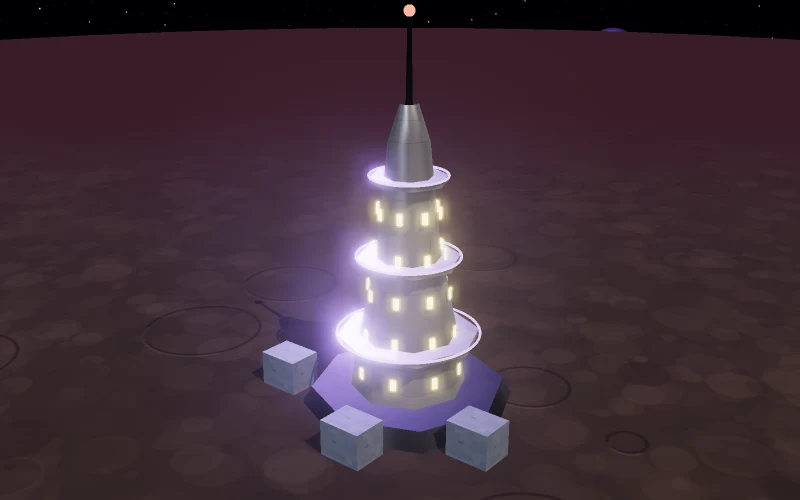 | **Command Nexus** Your empire's administration. Each level lets you hold more planets. Capital only. |
| 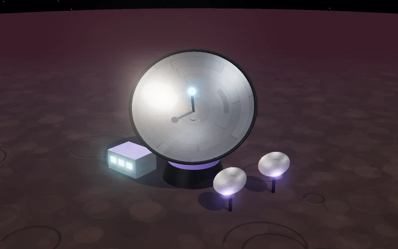 | **Deep Space Scanner** Watches the space around your planet: shows foreign fleets on your Radar, protects your explorers from ambushes, reveals what incoming attackers are made of, and makes it much harder to spy on this planet. |
|  | **Nano Forge** Swarms of tiny builders that make buildings, ships and defenses on this planet much faster. A late-game building that needs a lot of research and xenite. |
| 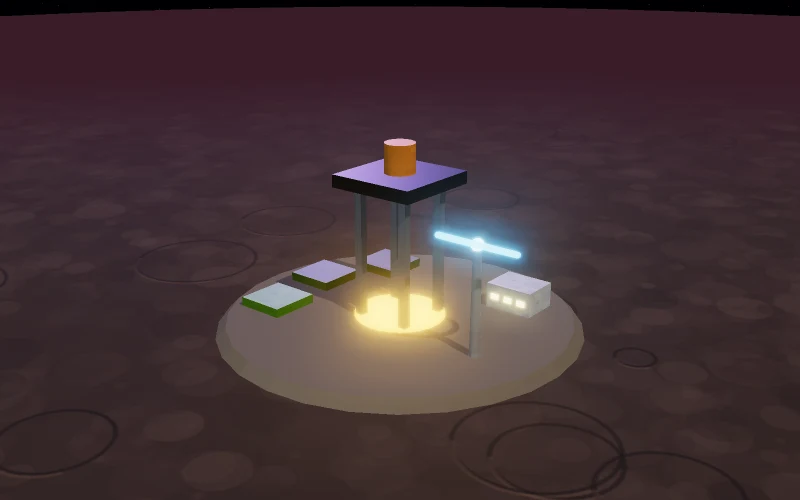 | **Planetary Development** Develops the whole planet so every mine produces more. Takes no building field. Each step needs the same level of Planetary Engineering research. |
| 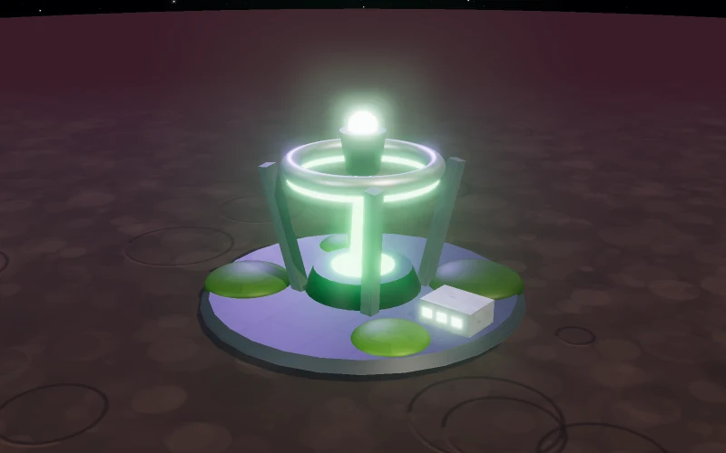 | **Terraformer** Reshapes the planet to make room for more buildings. Can be built even when the planet is full. |

## Defense

| | |
|---|---|
| 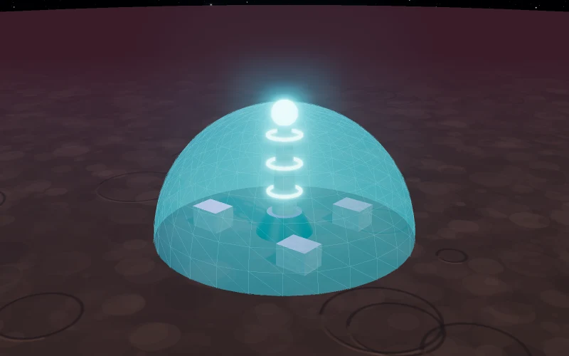 | **Planetary Shield** Puts a protective dome over the planet. It soaks up fire aimed at your defenses and docked ships until it collapses, and it comes back after every battle. |

For cannons and shield domes, see [Defenses](defenses.md).

## Demolishing

Any building can be taken down one level or completely. It takes half the time
it took to build and gives back part of what it cost. It's useful to free a
field for something more useful. Some things can't be demolished while you
need them, such as a Shipyard with orders in it.

## Learn more

- [Research](research.md): what your scientists can discover
- [Your planets](planets.md): fields, people, energy and storage
