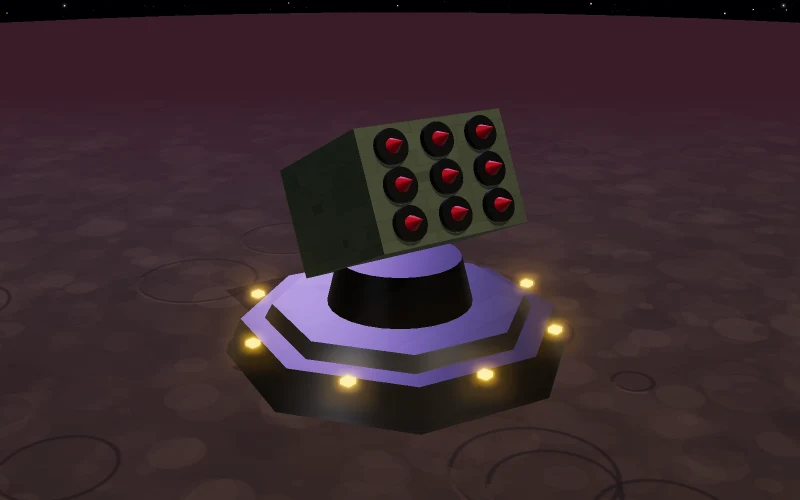
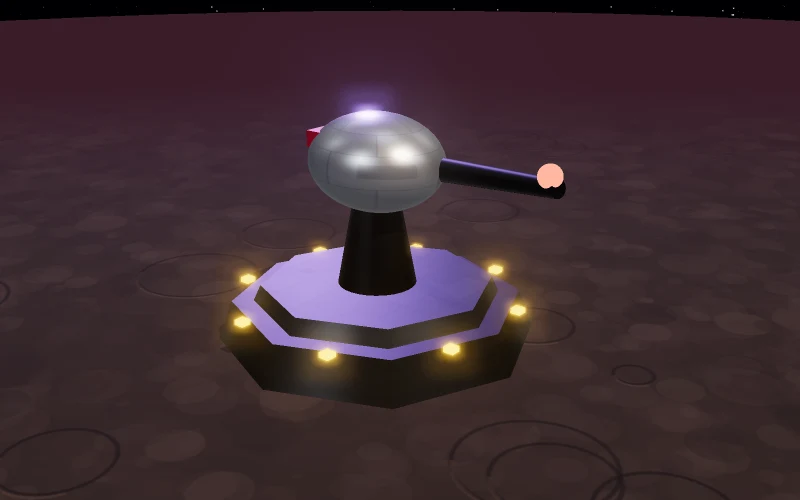
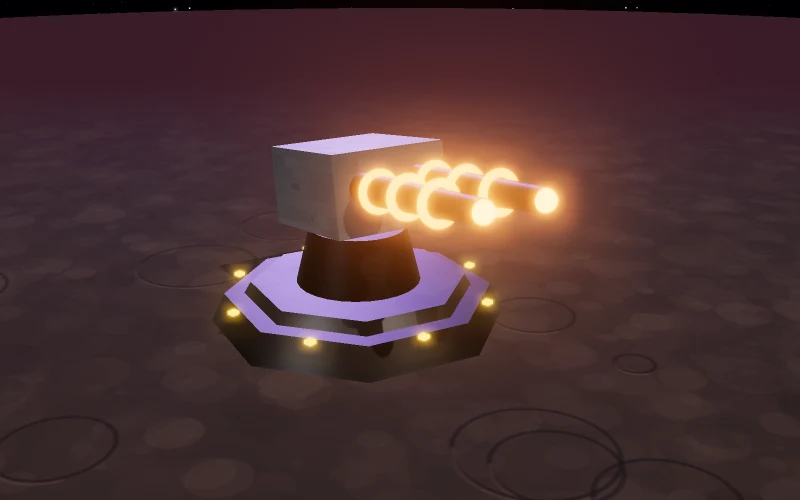
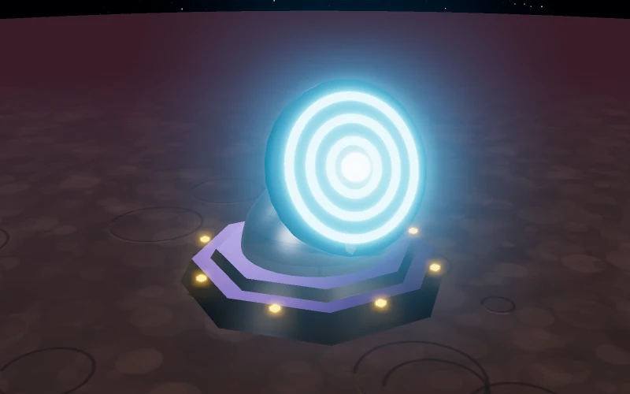
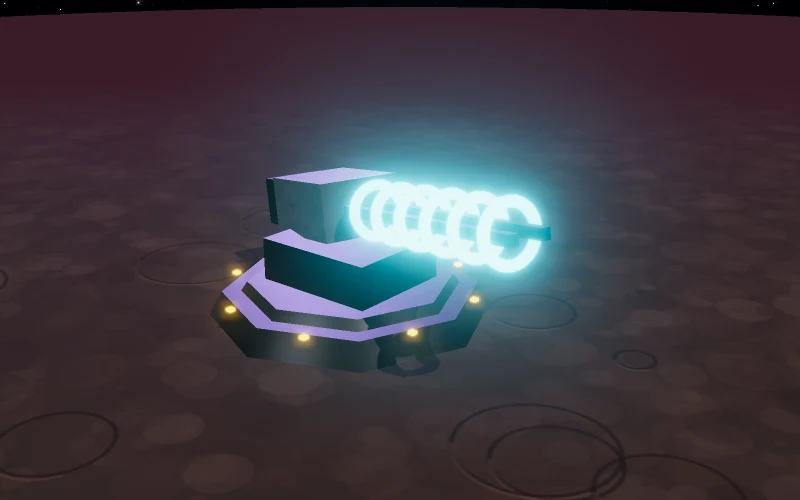
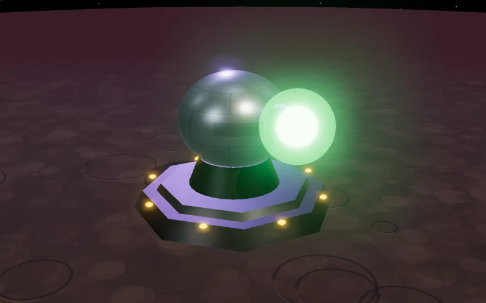
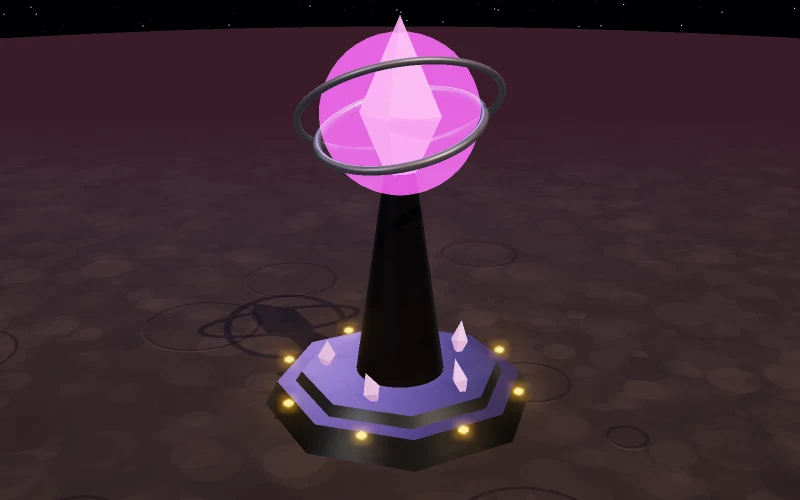
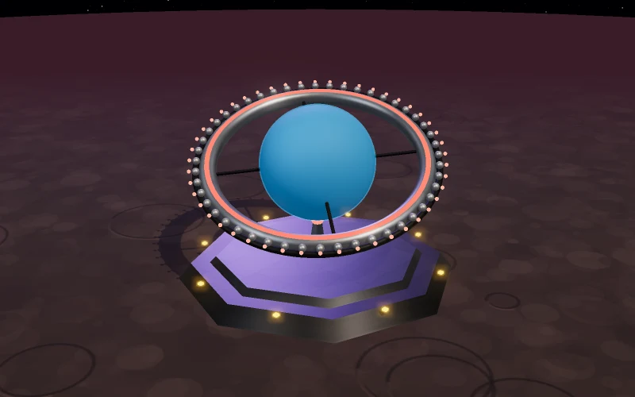
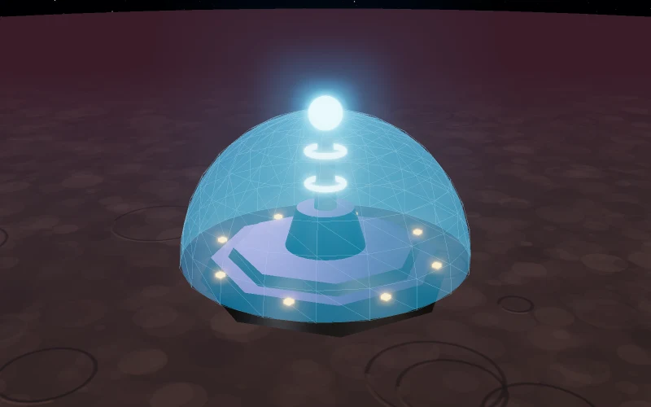
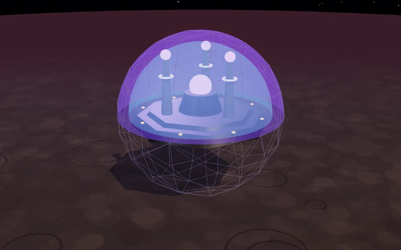

# Defenses

[← Back to the beginner's guide](../README.md)

Defenses stay on the planet and fight whenever it is attacked: by pirates, by
other empires, or by anyone trying to land troops. They are built at the
**Shipyard**, on the **Defense** page. Your docked ships fight beside them.

## Cannons

Each cannon is built to stop certain kinds of ships and hits them harder. The
game shows this as **Strong against** on every defense card. A good defense
mixes several kinds.

| | |
|---|---|
|  | **Missile Battery** Cheap launcher racks, easy to build in bulk. Its homing missiles are made for slow strike craft such as Bombers and Frigates. |
|  | **Light Laser Cannon** A rapid-firing turret that tracks small, fast fighters. Strong against Light, Heavy and Wing Fighters. |
|  | **Heavy Laser Cannon** A powerful laser battery for armored fighters and strike craft: Heavy Fighters, Interceptors and Bombers. |
|  | **Ion Cannon** A heavily shielded emplacement that soaks up fire. Its bursts cripple mid-sized ships such as Frigates and Cruisers. |
|  | **Gauss Cannon** Fires metal at tremendous speed, punching through the armor of Cruisers and Battleships. |
|  | **Plasma Turret** Fires bolts of plasma. Deadly to big ships: Battleships, Destroyers, Battlecruisers and Wing Carriers. |
|  | **Xenite Lance** An exotic beam powered by xenite, tuned to the cores of Xenite Dreadnoughts, and strong against Destroyers, Battlecruisers and Wing Carriers too. |
|  | **Orbital Ring** A ring around the whole planet, carrying hundreds of heavy cannons that each pick their own target. Strong against Cruisers, Battleships, Destroyers and Battlecruisers. A huge late-game project. Up to three per planet. |

## Shield domes

Shield domes have no guns at all. As long as one stands, **nothing else on the
planet can be destroyed**: every shot aimed at your cannons or docked ships
hits the dome instead. Each planet can have one of each dome.

| | |
|---|---|
|  | **Small Shield Dome** A light shield bubble. Early protection against small raids. |
|  | **Large Shield Dome** A heavy, layered barrier for a well-established planet. |
|  | **Mega Shield Dome** A fortress of overlapping barriers with a xenite core, by far the strongest dome. |

The **Planetary Shield** building adds another dome on top. It absorbs fire
before anything else and is restored after every battle. See
[Buildings](buildings.md#defense).

## After a battle

- Most destroyed defenses are rebuilt by themselves after the battle.
- Damaged defenses repair over time, faster with a bigger Robotics Factory.
- Every battle report has a **Rebuild** button that queues what you lost.

## Tips

- **Mix your cannons.** Each kind is strong against different ships, and
  attackers usually bring a mix.
- **Build a dome early.** It protects everything behind it, including the ships
  you have docked.
- **Defenses need people.** Every cannon needs workers. Without enough people,
  defenses fight weaker.
- **Hide what you have.** A Deep Space Scanner makes it much harder for others
  to spy on your planet, and an attacker who can't see your defenses has to
  guess.
- **Defenses can't follow you.** Pair them with a fleet that can intercept
  attackers before they arrive. See
  [Fleets and combat](fleets-and-combat.md#intercepting-a-fleet).

## Learn more

- [Dangers](dangers.md): who might attack you, and how to prepare
- [Ships](ships.md): the ships that fight beside your defenses
