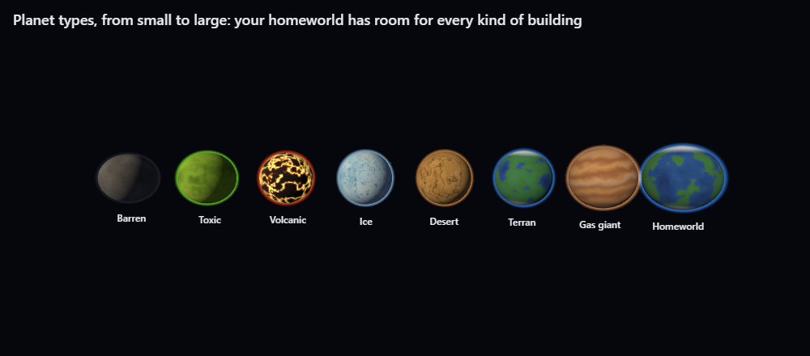
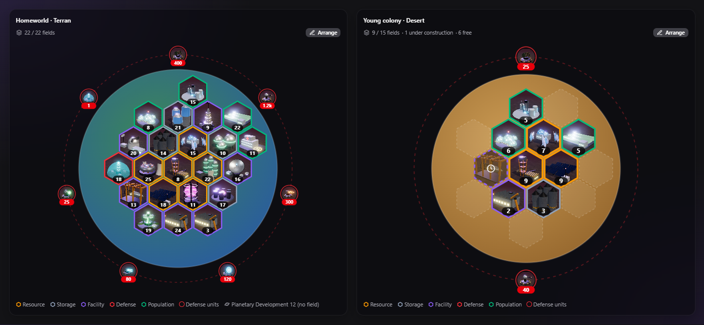

# Your planets

[← Back to the beginner's guide](../README.md)

Every world you hold is a small economy of its own: it mines, stores, houses
people and builds. This page explains how a planet works and how to keep it
running smoothly.

## Planet types

Worlds come in many kinds: barren, toxic, volcanic, ice, desert, ocean,
crystalline, terran and gas giants. Each kind has its own size and its own
riches. Some are rich in metal, others in crystal or deuterium, and a few hold
rare **xenite**. Cold worlds give more deuterium and water, and terran and ocean
worlds are good for farming.

Your **homeworld** is special: it is the one planet with room for every kind of
building. Every other world is smaller, so you have to choose what to build
there. A mining colony needs different buildings than a shipyard outpost.

## Building fields

The **Fields** bar on the Buildings page shows how much room a planet has left.
Each **kind** of building takes one field, whatever its level: once you have a
Metal Extractor, upgrading it never costs another field. Only a building you
don't have on that planet yet needs a free field.

- **Planetary Development** improves the whole planet and takes no field.
- The **Terraformer** grows a planet. It can be built even when every field is
  taken, because it brings its own room with it, and later levels add more.
- When a planet is full, you can still upgrade everything on it. To make room
  for something new, demolish a building you don't need.

## The surface map

Want to see your planet from above? On the **Overview**, the planet card has a
**Globe / Surface** switch. Click the planet (globe or surface) to open the full
surface map. The Buildings page has a **Map** view too.

- Each tile is one field, with the building's picture and its level on it.
- The tile's border shows the kind of building: resources, storage,
  facilities, defense or population.
- Faded tiles with a clock are still under construction; dashed tiles are free.
- Your defenses ring the planet, each with how many you have.
- Click a building to open its details.
- **Arrange** lets you move buildings around: tap a building, then the tile you
  want it on, or drag it there. **Auto** sorts everything again. Your layout is
  saved.

## People, water and food

Every planet has people, and they are your workers and crews.

- **Habitats** decide how many people a planet can hold. The population grows
  into the room while there is enough water and food.
- **Water Extractors** and **Hydroponic Farms** keep everyone supplied. Neither
  needs energy.
- Every building and defense needs workers, and every ship needs a crew. When a
  ship is finished, its crew comes from the planet's free people.
- Crews of ships docked at a planet live there: they need housing, water and
  food too.

**When something runs short**, the planet slows down. A planet without enough
water, food or workers mines less, builds and researches more slowly, and its
defenses and docked ships fight weaker. A hungry population shrinks, and an
overcrowded one loses people who move away. Ships without a crew wait in dock
until free people can board them.

Once a week, old age takes a small share of a planet's civilians. You'll get a
message when it happens.

> **Tip:** The **People** panel on the Overview shows everything at once: who
> lives there, how much room is left, who works where, and whether the water
> and food are enough.

## Energy

Mines need energy. **Solar Arrays** turn starlight into power; how much depends
on the system's star. **Fusion Reactors** burn deuterium for more power and work
the same around any star. If energy turns red in the top bar, your mines slow
down. Build power first.

## Storage

Each planet can only hold so much of each resource. When a store is full,
production of that resource stops.

- **Metal Vault**, **Crystal Vault**, **Deuterium Tank** and **Xenite Vault**
  raise the limits. Their top level removes the limit completely.
- If you ship more to a planet than it can store, a transport brings the rest
  back home. A fleet that lands for good (returning, deployed or settling)
  leaves extra metal and crystal in orbit as a debris field you can recycle;
  extra deuterium and xenite are lost. The game warns you before that happens.
- **Moons and space stations** have no mines, but they can store any amount.
  They are the perfect stockpile.

## Production rates

Right-click a resource in the top bar to set how hard the planet works it, from
full speed down to a pause. A mine running at half speed makes half as much,
uses half the energy and needs only half its workers. It's useful when energy
or workers are short, or when a store is full anyway.

## Colonies and your capital

- You start able to hold a few planets. The **Command Nexus**, built on your
  capital, raises that limit with every level. Moons and stations don't count.
- **Colonize** a free world you have charted with a Colony Ship.
- Any planet can become your new capital from its right-click menu, but only
  now and then, and never while an attack is coming. The Command Nexus is torn
  down when the capital moves, so build it again on the new one.
- A colony you no longer need can be **abandoned**. Its buildings stay behind
  for whoever settles it next.

## The Empire table

On the Overview, the **Table** button next to **Rankings** opens all your
planets side by side: stores, hourly output, population, buildings, ships and
defenses. Pick which planets to show at the top, fold the sections you don't
need, and click a planet's name to switch to it.

## Moons and space stations

- **Moons** can form from the wreckage of big battles, and a few systems have
  one from the start. Whoever owns the planet owns its moon.
- **Space stations** belong to some systems from the start, always held by
  pirates behind heavy defenses. Beat them, take their treasure, and settle the
  station with a Colony Ship.
- Both are small, have no mines, and can't hold every kind of building. But
  they store anything, their Deep Space Scanner works better, and their ships
  fight together with the planet's when it is attacked.
- A new moon has nobody living there yet. Bring people with Colonist Liners.

## Learn more

- [Buildings](buildings.md): every building and what it does
- [Dangers](dangers.md): illness, pirates and other threats to your planets
