# Ships

[← Back to the beginner's guide](../README.md)

The **Shipyard** builds every ship. Bigger ships need a bigger Shipyard and more
research; a locked card tells you what's missing. Click a ship's picture in the
game to see everything about it, including your research bonuses.

## Explorers

| | |
|---|---|
| 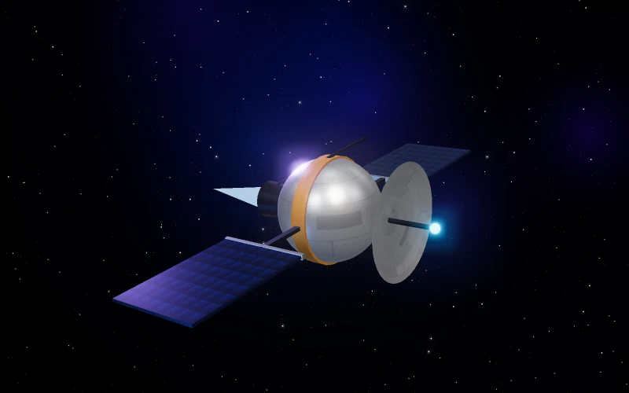 | **Spy Probe** Tiny, cheap and very fast. Your first explorer: it charts unknown worlds and spies on other planets. A fleet of only probes flies much faster than any other fleet. Defenceless, so keep it away from pirates. |
| 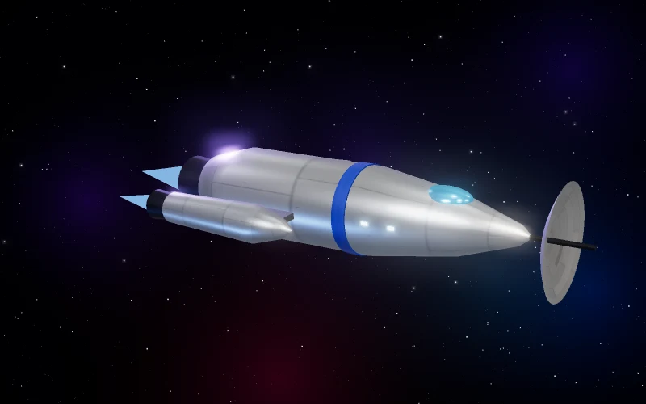 | **Pathfinder** A dedicated explorer. On expeditions it improves your chances of finding treasure. When spying it counts as many probes at once and is much harder to shoot down. Flies as fast as probes. |

## Warships

| | |
|---|---|
| 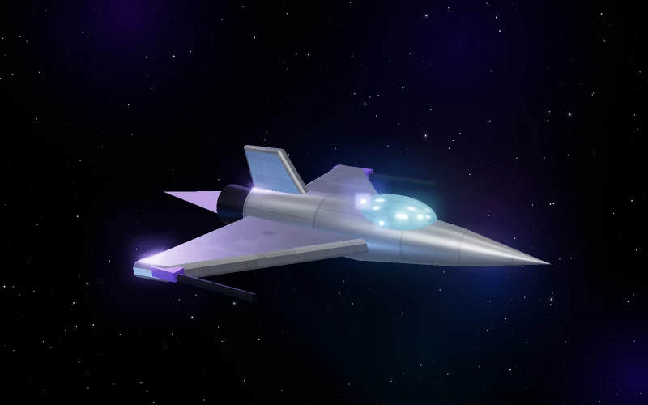 | **Light Fighter** Cheap and quick to build in large numbers. Good for soaking up enemy fire and for early defense. |
| 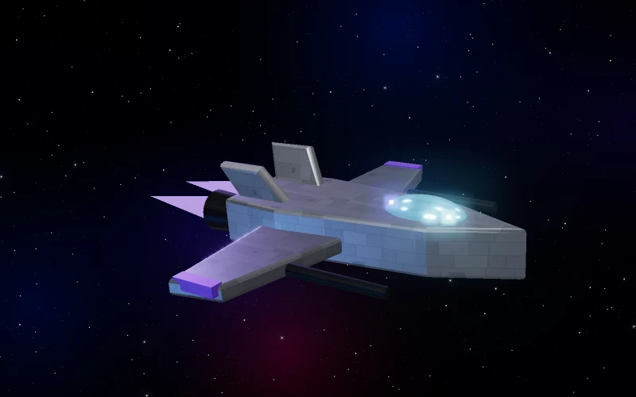 | **Heavy Fighter** An armored fighter with a stronger punch. |
| 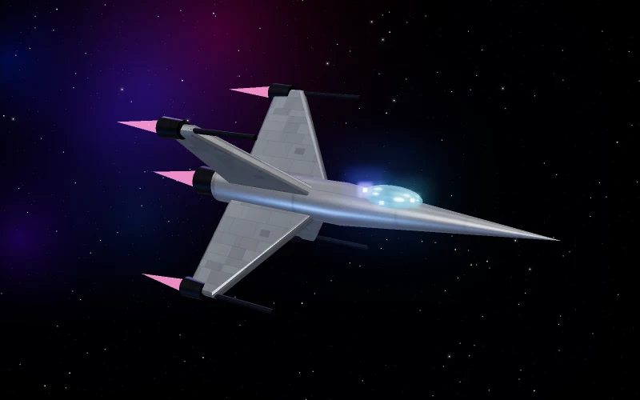 | **Interceptor** Very fast strike craft. Perfect for hunting pirates, catching fleets in deep space and quick raids. |
| 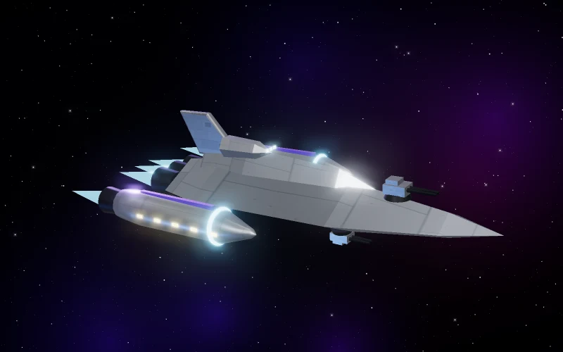 | **Frigate** A sturdy escort with several guns and a small cargo hold. |
| 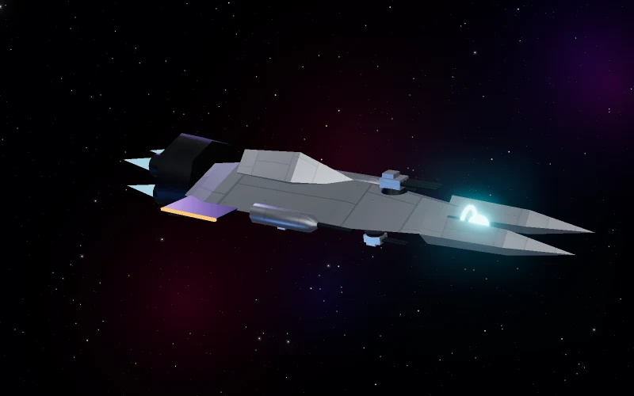 | **Cruiser** Fast and well-rounded: the workhorse of most fleets. |
| 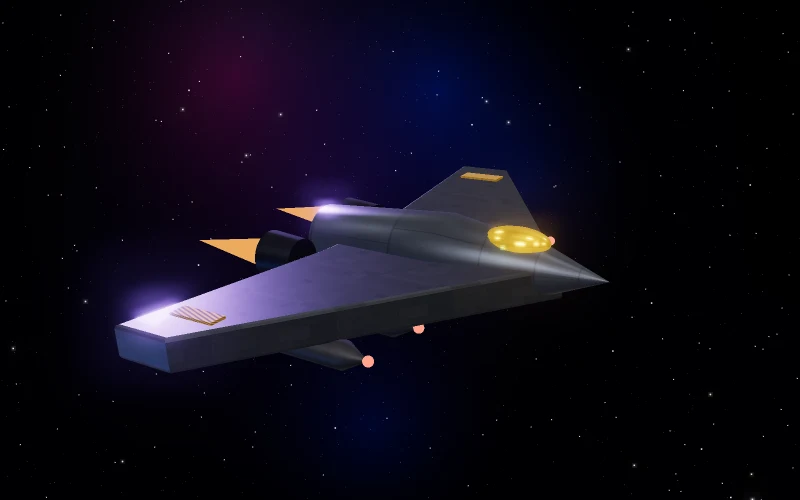 | **Bomber** A siege ship that hits planetary defenses especially hard. Bring it when you attack fortified planets. |
| 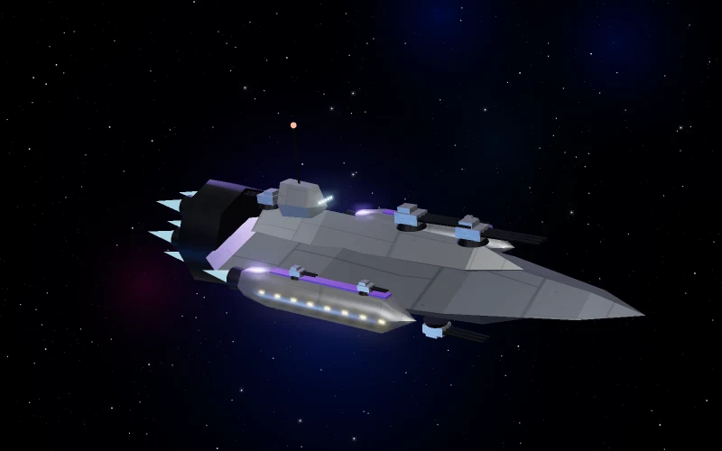 | **Battleship** A heavy line ship with thick armor and big guns. |
| 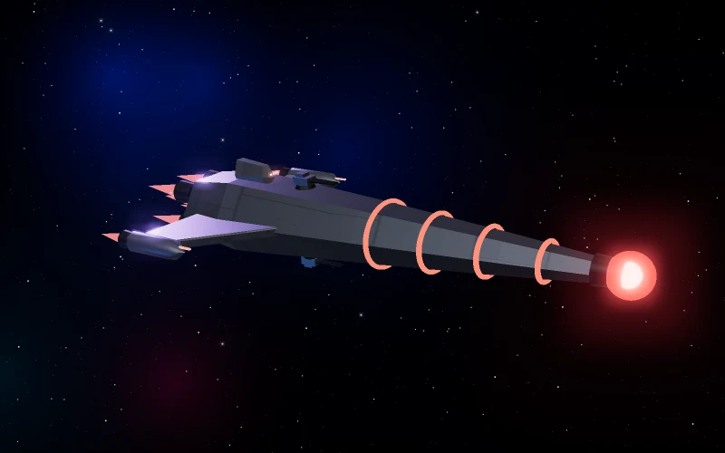 | **Destroyer** Slow, but devastating in a big battle. Its many guns can take out several smaller ships at once. |
| 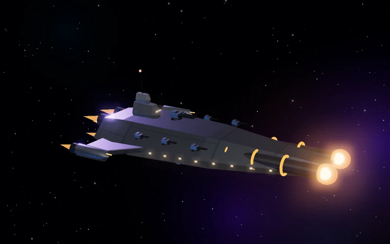 | **Battlecruiser** The heaviest ship built without xenite: twin spinal cannons and a broadside of batteries, armored to last many rounds. |
| 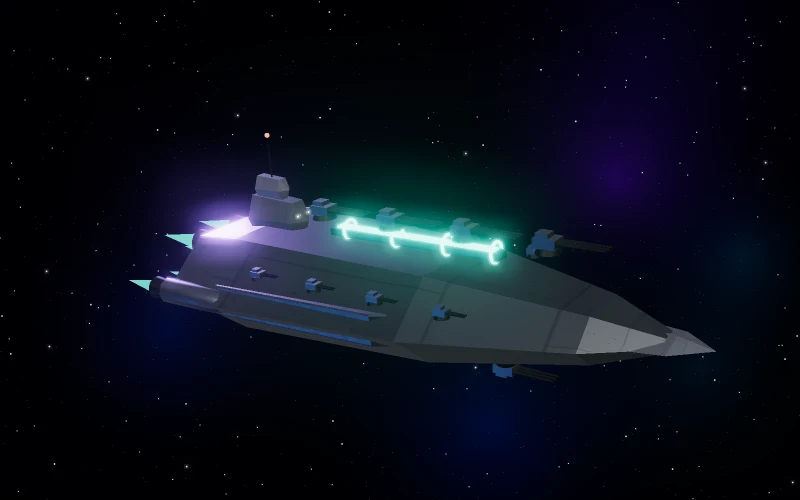 | **Juggernaut** A wall of armor around fourteen heavy batteries and a flak grid, between the Battlecruiser and the Dreadnought. Slow, but it holds the line through a whole battle and makes the ships around it tougher. |
| 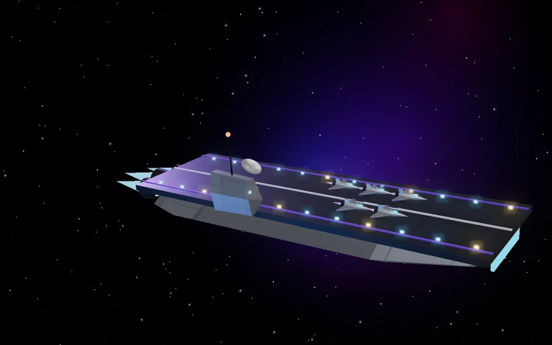 | **Wing Carrier** A flying hangar with no guns of its own. Its **Wing Fighters** launch at the start of every battle and are replaced after every battle the carrier survives. It also has a huge cargo bay. |
| 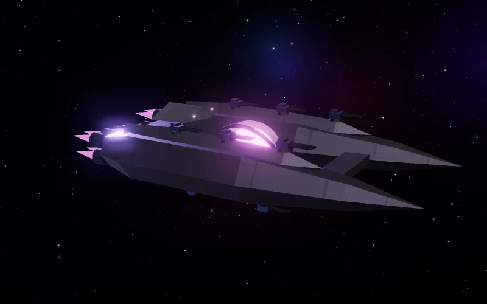 | **Dreadnought** A flying fortress grown around a xenite core, the most powerful ship anyone can build. It needs xenite, a top Shipyard, lots of research, and a high player level. |

## Hero ships

Heroes are legendary capital ships, stronger than a Dreadnought. You can
command **only one hero**, so choose well: a second one can't be built while
yours is docked, flying or still in the shipyard. Every hero buffs its **whole
fleet**, and while it sits in dock it also buffs **the planet it is docked
at**. Each carries a small wing of Wing Fighters. Heroes need a top Shipyard,
lots of research and a high player level, and all cost the same. The heroes
with fewer buffs hit harder; the ones with more buffs are a little weaker.

| | |
|---|---|
| 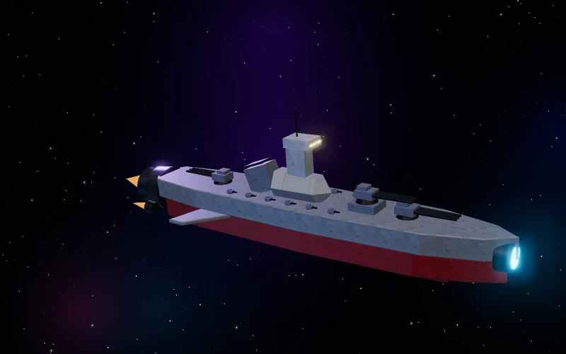 | **Yamato** The strongest hero. Its wave motion gun cracks orbital rings and shield domes. Its fleet hits harder, and the planet it guards gets stronger cannons. |
| 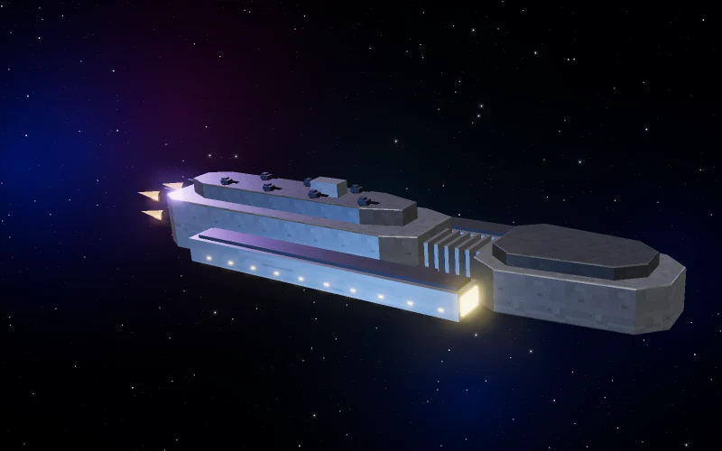 | **Galactica** A battlestar built to outlast anything, with a flak barrage that shreds fighter swarms. Its fleet gets tougher shields and hulls, and the planet it guards gets stronger shields. |
| 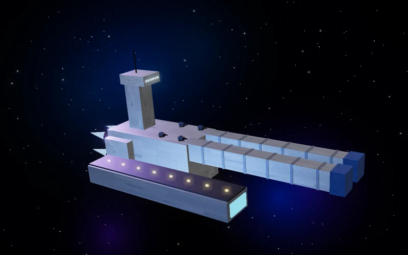 | **Macross** A flying fortress with a whole city inside and the biggest wing. Its fleet gets stronger shields and repairs lost ships after battle; its planet has room for more people and better cannons. |
| 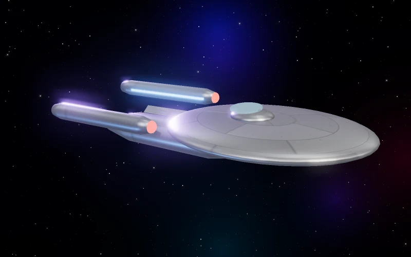 | **Voyager** The fastest hero, with the most buffs but the lightest guns. Its fleet flies faster, carries more and saves fuel; its planet mines more and builds and researches faster. |

## Civil ships

| | |
|---|---|
| 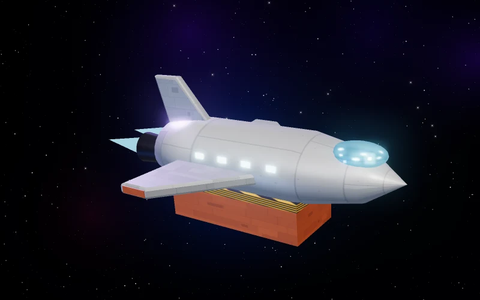 | **Small Cargo** A light transport for moving resources between your planets, and for carrying fuel and loot on missions. |
| 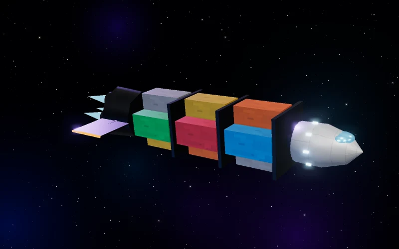 | **Large Cargo** A bulk freighter with a much bigger hold. |
| 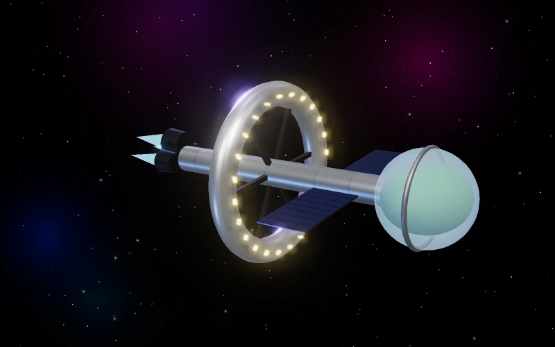 | **Colony Ship** Carries settlers to a free world you've charted and founds a colony there. It is used up when it lands. Also needed to invade an enemy colony. |
| 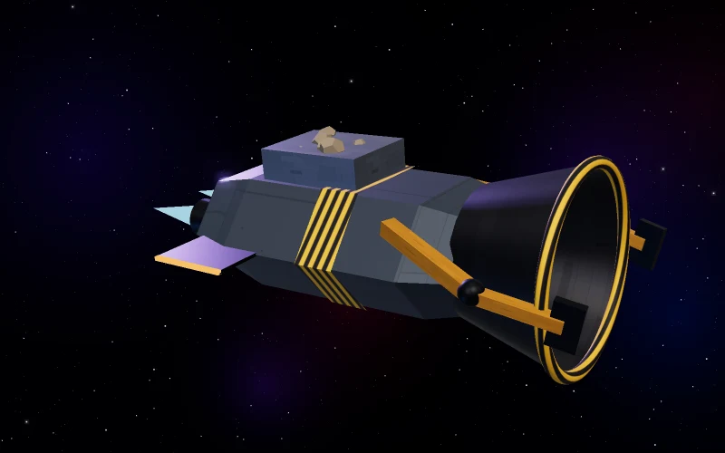 | **Recycler** Collects the debris fields battles leave behind, turning wreckage back into metal and crystal. |
| 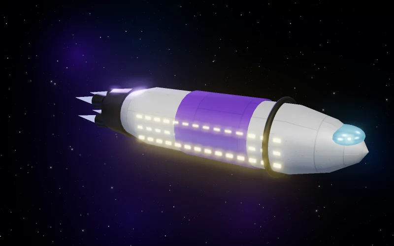 | **Colonist Liner** Carries people between your planets, to staff a growing colony or a new moon. |

## Good to know

**Crews.** Every ship needs a crew from the planet's free people. A ship
finished on a planet without enough free people waits in dock until it can be
crewed. See [Your planets](planets.md#people-water-and-food).

**Fleet auras.** Every ship type helps the other ships flying with it: probes
improve targeting, fighters screen with their shields, cruisers coordinate
fire, battleships keep everyone together, large cargo ships save fuel, and so
on. Mixed fleets are stronger than fleets of a single type. The fleet dispatcher
shows which auras are active.

**Gun types.** From the Frigate up, warships carry two kinds of guns (heroes
three): light guns that are good against fighters, and heavy guns that find
big ships. Each kind also has weak points it hits harder, including some of
the cannons built to stop that ship. Open a ship's card to see its guns, and
what is strong against it.

**Quantum ships.** The **Quantum Drive** research unlocks a Quantum version of
every ship: twice as fast, a little stronger, and more expensive. They have a
blue ring around their picture. The Shipyard then has a switch to build
standard or Quantum ships, and both can fly together.

**Upkeep.** Warships sitting in dock use a little deuterium over time, and ships
built with xenite also use a little xenite. Ships in flight pay with fuel
instead. Civil ships cost nothing while docked.

**Damage and repairs.** Ships that survive a battle keep their damage. Shields
recharge quickly anywhere. Hulls are repaired fastest in dock (faster with a
bigger Robotics Factory and Shipyard) and slowly in flight. Badly damaged ships
wait in the repair dock until they're ready to fly again.

## Learn more

- [Fleets and combat](fleets-and-combat.md): how to send ships, attack and
  intercept
- [Defenses](defenses.md): the other half of your military
